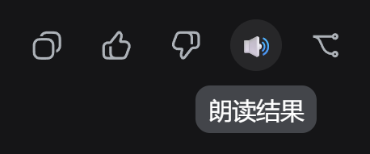
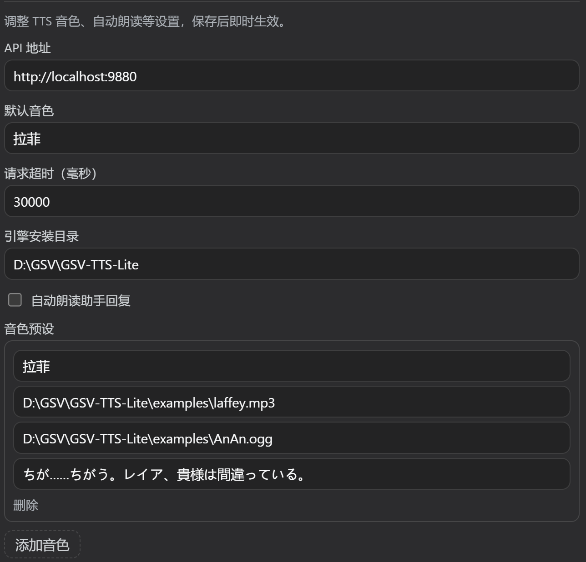
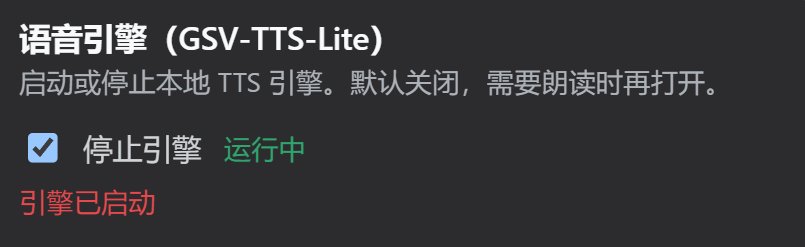
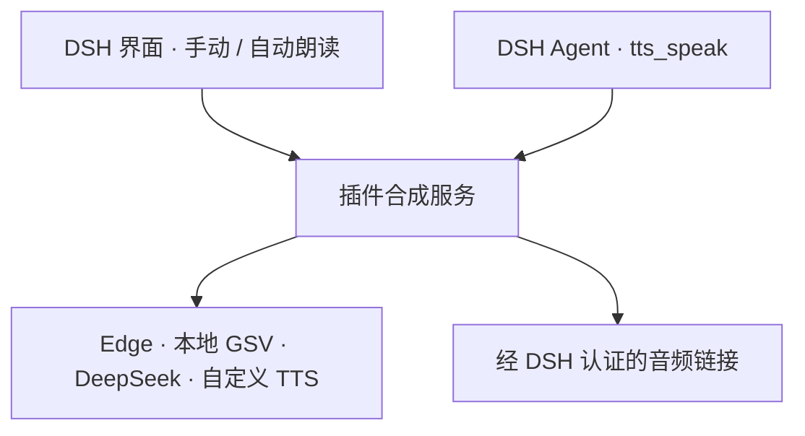

<p align="center">
  
</p>

<h1 align="center">dsh-gsv-tts</h1>

<p align="center"><strong>在 DeepSeek Harness 里听助手回复。</strong></p>

<p align="center">
  一键朗读消息，边生成边听，长回复还可以下载。<br>
  默认用 Edge 开始，随时切换到本地 GSV、DeepSeek 官方语音或自己的 TTS 服务。
</p>

<p align="center">
  <a href="https://www.npmjs.com/package/dsh-gsv-tts"></a>
  <a href="https://www.npmjs.com/package/dsh-gsv-tts"></a>
  <a href="https://github.com/TaoruiLiu19/dsh-gsv/actions/workflows/ci.yml"></a>
  <a href="LICENSE"></a>
</p>

<p align="center">
  <a href="https://awesome-dsh-plugin.com/p/TaoruiLiu19/dsh-gsv/"></a>
  <a href="https://taoruiliu19.github.io/gsv-market/"></a>
  <a href="https://dsh-insights.com/p/TaoruiLiu19/dsh-gsv/?utm_source=badge&amp;utm_medium=readme&amp;utm_campaign=TaoruiLiu19/dsh-gsv"></a>
</p>

<p align="center">
  <a href="#quick-start"><strong>快速安装</strong></a> ·
  <a href="https://taoruiliu19.github.io/gsv-market/"><strong>在线试听</strong></a> ·
  <a href="#choose-a-voice-provider">选择语音</a> ·
  <a href="README_EN.md">English</a>
</p>

<a name="quick-start"></a>

## 快速上手

适用于 DSH `0.2.2-rc.1` 起的 `0.2.x` 版本。在终端安装到你的 DSH profile。

```bash
dsh plugin --profile web add dsh-gsv-tts
```

桌面版使用 `desktop` profile 时，将命令中的 `web` 换成 `desktop`。重启 DSH，在插件页启用 **dsh-gsv-tts**，然后点击任意助手消息旁的 **🔊 朗读结果**。首次安装默认选中 Edge，联网即可试听。

<p align="center">
  
</p>

> **可以这样试。** 让 DSH「用三句话介绍你正在做的项目」，然后点一下 🔊。只想听其中一句时，选中那段文字，再点选区旁的朗读按钮。

<details>
<summary>从 GitHub 安装或从旧版升级</summary>

```bash
dsh plugin --profile web add "github:TaoruiLiu19/dsh-gsv"
```

Git 安装会运行 `prepare` 构建。若 pnpm 提示拦截了构建脚本，在该 profile 的 `pnpm-workspace.yaml` 中按提示把对应项目加入 `allowBuilds`，再重试。npm 安装使用预构建产物。

已有提供方配置会沿用。旧配置未指定提供方但已有本地音色时，升级后使用 GSV。

</details>

## 三种听法

| 想怎么听 | 在 DSH 里这样做 |
| --- | --- |
| **只听重点** | 点击消息旁的 🔊 朗读整条可见回复，或选中一段文字单独朗读。 |
| **边生成边听** | 在「设置 → 声音设置」开启「自动朗读助手回复」和「生成时逐句朗读可见正文」。生成出完整句子就可以开始听。模型重试或取消时，对应的待播语音会撤销。 |
| **跟读、回听或带走** | 用浮动播放器调倍速和音量。开启「逐句跟读」后，从下一次朗读开始可跳句、看高亮、导出 SRT。点击「整段」可获得可拖动进度的音频，也能直接下载。 |

自动朗读默认关闭。开启后，可以在声音设置选择新回复是否打断当前播放。Edge 和 GSV 提供对齐数据时，跟读还会在播放器内标记当前词或字。

<a name="choose-a-voice-provider"></a>

## 选择语音提供方

在 **设置 → 声音设置 → TTS 模式** 切换。四个提供方分别记住选过的默认音色。

| 提供方 | 适合谁 | 上手条件 |
| --- | --- | --- |
| **Edge** · 快速体验 | 想先听一遍，从晓晓、云希或 Aria 等音色选起 | 联网即可 |
| **GSV-TTS-Lite** · 本地专业 | 想做本地离线合成，或用自己拥有授权的参考音频克隆音色 | 安装引擎，准备模型和音色 |
| **DeepSeek** · 官方语音 | 想使用海星 `stella` 或暗潮 `tide` | 可复用 DSH 中保存的 API Key，按字符计费 |
| **自定义 TTS** | 已在使用 Kokoro-FastAPI 或其他 OpenAI 兼容语音服务 | 填写 Base URL、模型和音色 |

<details>
<summary>查看声音设置和本地引擎截图</summary>

<p align="center">
  
  <br>
  
</p>

</details>

## 播放与可靠性

- **边播边下载。** 同一段音频的并发播放与下载可以复用一个上游合成任务。各端可独立取消，最后一个使用者取消时才结束上游合成。
- **预算随 DSH 用户目录走。** DeepSeek 自动朗读可以设置每日字符上限。同一 DSH 用户目录的工作区和 profile 共用用量账本。留空为不限，填 `0` 可阻止新的自动合成。最终费用以服务方账单为准。
- **音色成对安装。** 音色市场在下载时限制清单和音频体积并校验 SHA-256。参考音频与提示音频全部通过才一起发布，设置写入失败会保留原来的音色。
- **关掉插件就停。** 热重载和禁用会停播、取消在途请求并清理浮层。启用 DSH 宿主的语音输入后，录音或转写期间也会暂停自动朗读。 [DSH 语音输入指南](https://github.com/deepseek-ai/deepseek-harness/blob/dsh-v0.2.2-rc.1/packages/experimental/voice-input-bundle/README.zh.md)

## 配出顺耳的声音

### 音色市场

先在网页听，再去插件内安装。在 GSV 模式打开 **声音设置 → 音色市场**，查看音色的来源、作者和许可，试听后选择安装。远端新增音色需二次确认。已安装的市场音色会加入本地预设，卸载时可选择是否删除文件。 [在线试听](https://taoruiliu19.github.io/gsv-market/) · [投稿指南](docs/VOICE_MARKET.md)

### 发音词典

在「声音设置 → 发音词典」每行写一条 `原词=读法`。可以为不同提供方指定读法，让项目名、缩写或多音字读起来更自然。

```ini
# 全局规则
DSH=DeepSeek

[gsv]
GSV=G S V
```

同名规则按提供方优先，长词优先匹配。调用 `tts_lexicon_preview` 可预览替换结果，这一步只处理文本。

<details>
<summary>本地 GSV 安装、模型与音色预设</summary>

1. 准备 Git 和 Python 3.10+，切到 GSV 后，让 agent 调用 `tts_setup_engine`。确认安装操作后，插件会将 GSV-TTS-Lite 0.4.7 的固定提交和 Python 虚拟环境放到 `installDir` 下。
2. 将模型放到 `<installDir>/models`。旧安装的 `<installDir>/API/models` 也可继续使用。引擎日志在 `<installDir>/logs/engine.log`。
3. 从音色市场装一个预设，或填写音色名称、目标音色参考音频、提示音频和对应的提示文本。音频路径应能被引擎读取。使用自己拥有授权的音频。
4. 在声音设置启动引擎。默认「节能」由你手动启动，「常驻」会自动启动并预热默认音色。准备好模型和引擎后，本地合成可离线工作。

用 `gsvModelManifest` 指向可信来源提供的 JSON 校验清单，格式为 `{"version":"模型版本","files":{"s1v3.ckpt":"对应文件的 SHA-256"}}`。为默认 GPT 和 SoVITS 权重都填写哈希。设置后，托管引擎启动前会检查文件。

自行管理引擎时，可在自己的虚拟环境内安装依赖并启动服务，然后把 `apiUrl` 指向该服务。

```bash
python -m pip install -c scripts/gsv-constraints.txt -r scripts/gsv-requirements.txt
python scripts/dsh_stream_api.py -p 9880 --models_dir "<模型绝对路径>"
```

</details>

<details>
<summary>DeepSeek 凭据、自定义 TTS 与兼容性</summary>

- **DeepSeek 凭据。** 默认按 `DEEPSEEK_API_KEY` 的引用名查找 DSH 凭据，也可使用同名环境变量。插件中手填的 Key 优先。仅登录 DeepSeek 账号的情况下，需先配置 API Key。配置了 `DEEPSEEK_BASE_URL` 的环境会将语音请求发给该地址。
- **自定义 TTS。** 例如 Kokoro-FastAPI 可尝试 Base URL `http://127.0.0.1:8880/v1`、模型 `kokoro`、音色 `af_sarah`。格式支持 24 kHz PCM 或单声道 16-bit WAV。凭据按 DSH 引用名配置，语气和停顿指令由后端决定是否支持。
- **缓存和用量。** 音频链接通过已认证的 DSH 同源路由提供，实例内的缓存最长保留 24 小时，并受 200 个文件、256 MiB 上限限制。可在声音设置查看首音时延、缓存命中和失败次数。DeepSeek 用量账本位于 DSH 用户目录的 `gsv-tts/speech-usage.sqlite`。
- **设置持久化。** 声音设置可在运行中保存。当前 profile 的覆盖配置位于 `$DSH_HOME/profiles/<profile>/cordis.patch.yml`，默认 DSH 用户目录为 `~/.dsh`。 [完整配置定义](src/index.ts)

| 常用配置键 | 作用 |
| --- | --- |
| `autoPlay` · `liveReply` · `interruptOnNew` | 自动朗读、生成时逐句朗读、用新回复打断当前播放。默认依次为 `false`、`false`、`true`。 |
| `engineMode` · `apiUrl` · `installDir` | 默认使用节能模式，连接 `http://localhost:9880`，引擎目录为 `./GSV-TTS-Lite`。 |
| `gsvSpeed` · `timeout` | GSV 合成语速默认为 `1`。常规请求超时默认为 `30000` 毫秒。 |
| `voiceRegistryUrl` | 默认使用音色市场清单。留空只加载包内清单。 |

</details>

## 遇到问题

| 现象 | 先检查什么 |
| --- | --- |
| 装好后找不到朗读按钮 | 插件是否装到当前 profile 并已启用，并检查 DSH 版本。 |
| Edge 选好音色却不出声 | 在声音设置查看云端通道状态，确认联网。Edge 通道可能限流。 |
| GSV 提示引擎未启动或模型缺失 | 用 `tts_doctor` 检查引擎、模型路径和最近一次失败，再按建议启动或补齐文件。 |
| DeepSeek 提示凭据无效 | 确认 DSH 保存了 API Key。可以让 agent 调用 `tts_doctor` 并传入 `deep=true` 探活。 |

<details>
<summary>Agent 可调用的工具</summary>

| 工具 | 用途 |
| --- | --- |
| `tts_speak` · `tts_list_voices` | 合成指定文本并返回音频链接，或列出当前提供方的音色。 |
| `tts_doctor` · `tts_health_check` | 查看凭据来源、引擎、模型、日志和最近失败，或快速检查当前通道。 |
| `tts_setup_engine` | 经用户确认后安装本地 GSV-TTS-Lite。 |
| `tts_voice_registry` · `tts_voice_install` · `tts_voice_remove` | 浏览、安装或卸载市场音色。 |
| `tts_lexicon_preview` | 预览文本应用发音词典后的读法。 |

</details>

## 参与项目

有想分享的音色，欢迎投稿。碰到播放或安装问题，欢迎在 Issue 里附上 DSH 版本、所选提供方和复现步骤。觉得顺手的话，也欢迎给项目点个 Star。 [音色投稿](docs/VOICE_MARKET.md)

<details>
<summary>本地构建与发布验证</summary>

```bash
pnpm install
pnpm clean
pnpm build
pnpm verify
pnpm test
pnpm test:release
```

服务端用 TypeScript，浏览器脚本在 `client/`，构建产物在 `lib/`。`test:release` 会把打出的 tarball 装进真实 DSH 的临时 Web profile，验证客户端加载、音色切换和朗读下载链路，语音请求由模拟服务应答。 [发布指南](docs/PUBLISHING.md)

界面和 Agent 工具共用同一套合成服务。



</details>

[更新记录](CHANGELOG.md) · [提交 Issue](https://github.com/TaoruiLiu19/dsh-gsv/issues) · [Awesome DSH Plugin](https://awesome-dsh-plugin.com/p/TaoruiLiu19/dsh-gsv/) · [DSH Insights](https://dsh-insights.com/p/TaoruiLiu19/dsh-gsv/) · [MIT 许可证](LICENSE) · © 2026 TaoruiLiu19
