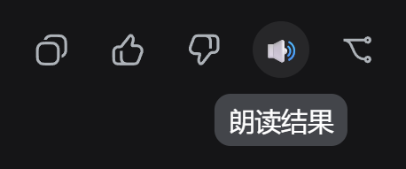
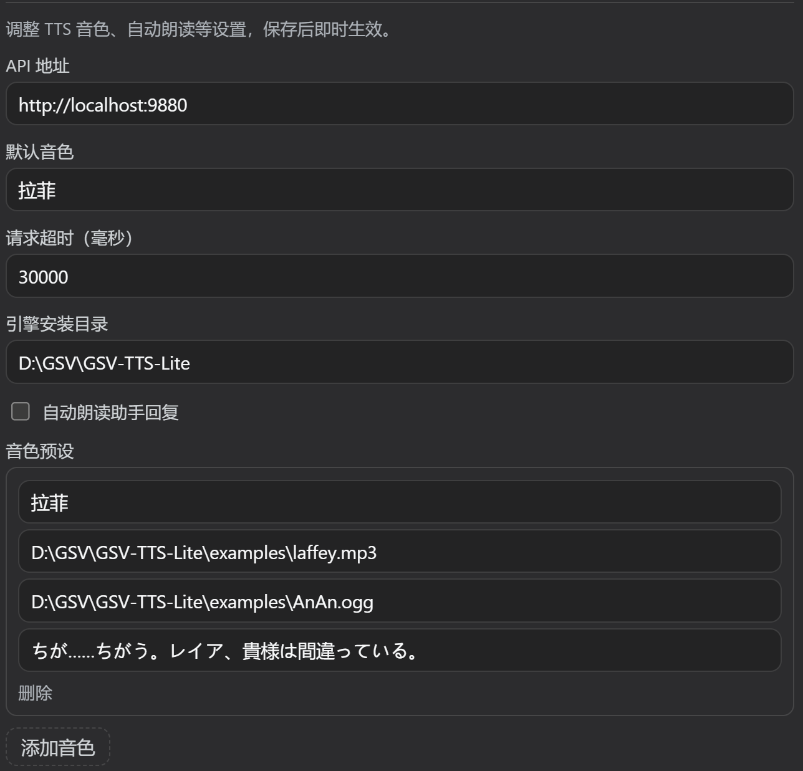
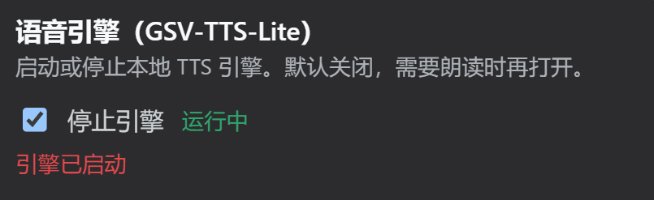
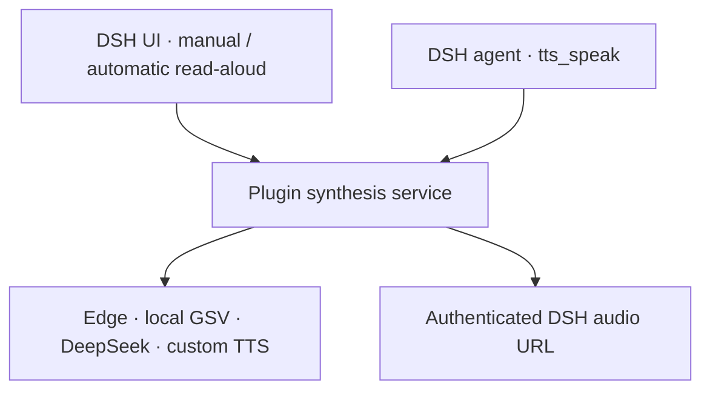

<p align="center">
  
</p>

<h1 align="center">dsh-gsv-tts</h1>

<p align="center"><strong>Listen to your DeepSeek Harness replies.</strong></p>

<p align="center">
  Read a reply aloud, listen as it streams in, or save it for later.<br>
  Start with Edge and switch to local GSV, official DeepSeek voices, or your own TTS endpoint whenever you like.
</p>

<p align="center">
  <a href="https://www.npmjs.com/package/dsh-gsv-tts"></a>
  <a href="https://www.npmjs.com/package/dsh-gsv-tts"></a>
  <a href="https://github.com/TaoruiLiu19/dsh-gsv/actions/workflows/ci.yml"></a>
  <a href="LICENSE"></a>
</p>

<p align="center">
  <a href="https://awesome-dsh-plugin.com/p/TaoruiLiu19/dsh-gsv/"></a>
  <a href="https://taoruiliu19.github.io/gsv-market/"></a>
  <a href="https://dsh-insights.com/p/TaoruiLiu19/dsh-gsv/?utm_source=badge&amp;utm_medium=readme&amp;utm_campaign=TaoruiLiu19/dsh-gsv"></a>
</p>

<p align="center">
  <a href="#quick-start"><strong>Install</strong></a> ·
  <a href="https://taoruiliu19.github.io/gsv-market/"><strong>Preview voices</strong></a> ·
  <a href="#choose-a-voice-provider">Choose a provider</a> ·
  <a href="README.md">简体中文</a>
</p>

## Quick start

Requires DSH `0.2.2-rc.1` or a later `0.2.x` release. Install the package into your DSH profile.

```bash
dsh plugin --profile web add dsh-gsv-tts
```

Use `--profile desktop` if your desktop app uses that profile. Restart DSH, enable **dsh-gsv-tts** in Plugins, and click **🔊 Read aloud** next to an assistant message. Fresh installs start with Edge and need an internet connection.

<p align="center">
  
</p>

> **Try this first.** Ask DSH to describe your project in three sentences, then click 🔊. To hear a single sentence, select it and use the button next to the selection.

<details>
<summary>Installing from GitHub or upgrading an older setup</summary>

```bash
dsh plugin --profile web add "github:TaoruiLiu19/dsh-gsv"
```

Git installs build via `prepare`. If pnpm blocks the build script, add the package it reports to `allowBuilds` in the profile's `pnpm-workspace.yaml` and retry. The npm package ships prebuilt files.

Explicit provider choices carry forward. Older configurations with voice presets and no provider setting use GSV after the upgrade.

</details>

## Three ways to listen

| What you want | How to do it in DSH |
| --- | --- |
| **Hear the important bit** | Click 🔊 to hear the visible reply, or select a passage and read just that selection. |
| **Listen as DSH writes** | In **Settings → Voice Settings**, enable **Auto-read assistant replies** and **Read visible sentences while the reply streams**. Playback can begin once a sentence is complete. Retries and cancellations remove the associated queued audio. |
| **Follow along or save it for later** | Adjust speed and volume in the floating player. Enable sentence following before the next read to jump between sentences, see highlights, or export SRT subtitles. Generate the full, seekable audio when you want to replay or download it. |

Auto-read is off by default. When enabled, you can choose whether a new reply interrupts current playback. Edge and GSV can highlight the current word or character when alignment data is available.

## Choose a voice provider

Switch in **Settings → Voice Settings → TTS Mode**. Each provider remembers its own default voice.

| Provider | Good for | What it needs |
| --- | --- | --- |
| **Edge** · Quick | Hearing your first reply with voices such as Xiaoxiao, Yunxi, or Aria | An internet connection |
| **GSV-TTS-Lite** · Local Pro | Offline synthesis and voice cloning from reference audio you have permission to use | A local engine, model files, and a voice preset |
| **DeepSeek** · Official | Using the official Stella (`stella`) and Tide (`tide`) voices | A DeepSeek API key, which can come from DSH's credentials store. Billed per character. |
| **Custom TTS** | Connecting Kokoro-FastAPI or another OpenAI-compatible speech service | Base URL, model, and voice |

<details>
<summary>See the Voice Settings panel and local engine controls</summary>

<p align="center">
  
  <br>
  
</p>

</details>

## Playback and reliability

- **Listen while you download.** Concurrent playback and downloads of identical speech can share a synthesis job. Each listener can cancel independently. The upstream task stops when the last listener cancels.
- **Keep your budget across workspaces.** The optional DeepSeek auto-read character limit uses one daily ledger per DSH user directory, shared by its workspaces and profiles. Leave the limit blank for unlimited auto-read or set it to `0` to stop new automatic synthesis. Check the provider's bill for actual charges.
- **Install both voice files together.** The Voice Market enforces transfer limits and verifies SHA-256 during download. It publishes the speaker and prompt files after both pass, and preserves the old voice if saving the new configuration fails.
- **Stop when the plugin closes.** Disabling or hot-reloading the plugin stops playback, cancels pending requests, and removes the player UI. If you enable DSH's optional voice input, recording and transcription pause automatic reading. [DSH voice input guide](https://github.com/deepseek-ai/deepseek-harness/blob/dsh-v0.2.2-rc.1/packages/experimental/voice-input-bundle/README.md)

## Make it sound right

### Voice Market

Preview voices on the website or inside **Voice Settings → Voice Market** in GSV mode. Check the source, author, and license before installing. New voices from a remote registry require a second confirmation. Installed voices appear in the local preset list, and you can choose whether to keep the downloaded files when uninstalling. [Preview voices online](https://taoruiliu19.github.io/gsv-market/) · [Submission guide](docs/VOICE_MARKET.md)

### Pronunciation lexicon

Add one `word=reading` rule per line in **Voice Settings → Pronunciation lexicon**. Add provider sections to give acronyms, names, or ambiguous words different readings when needed.

```ini
# Global rule
DSH=DeepSeek

[gsv]
GSV=G S V
```

Provider-specific rules override the global rule for the same word, and longer matches take precedence. Use `tts_lexicon_preview` to see the rewritten text before synthesizing anything.

<details>
<summary>Local GSV setup, models, and presets</summary>

1. Install Git and Python 3.10+. Switch to GSV and ask the agent to run `tts_setup_engine`. After you confirm, the installer places a pinned GSV-TTS-Lite 0.4.7 checkout and an isolated Python environment under `installDir`.
2. Place models in `<installDir>/models`. Existing installs can keep their files in `<installDir>/API/models`. Engine logs are in `<installDir>/logs/engine.log`.
3. Install a preset from the Voice Market or enter a name, target reference audio, prompt audio, and matching prompt text. Use permitted audio files that the engine can access.
4. Start the engine in Voice Settings. In **Eco** mode, use the switch to start it manually. **Always-on** starts automatically and prewarms the default voice. Once ready, the engine can synthesize offline.

Point `gsvModelManifest` to a trusted JSON manifest such as `{"version":"model release","files":{"s1v3.ckpt":"expected SHA-256"}}`. Include the hashes for both default GPT and SoVITS weights. With a manifest configured, the managed launcher verifies the model files before starting.

For a self-managed engine, install the dependencies in your virtual environment, start the service, and set `apiUrl` in Voice Settings.

```bash
python -m pip install -c scripts/gsv-constraints.txt -r scripts/gsv-requirements.txt
python scripts/dsh_stream_api.py -p 9880 --models_dir "/absolute/path/to/models"
```

</details>

<details>
<summary>DeepSeek credentials, custom endpoints, and settings</summary>

- **DeepSeek credentials.** The default reference is `DEEPSEEK_API_KEY`. The plugin looks in DSH's credentials store and can fall back to the environment variable. A key entered in the plugin takes precedence. A DeepSeek account sign-in still needs an API key for TTS. If you set `DEEPSEEK_BASE_URL`, the plugin uses that endpoint for speech requests.
- **Custom TTS.** For Kokoro-FastAPI, try Base URL `http://127.0.0.1:8880/v1`, model `kokoro`, and voice `af_sarah`. The plugin accepts 24 kHz PCM or mono 16-bit WAV. For authentication, enter a DSH credential reference. Voice and pause instructions depend on the connected service.
- **Cache and usage.** Audio URLs are served on authenticated, same-origin DSH routes. The instance cache retains files for up to 24 hours, within 200 files and 256 MiB. Voice Settings shows first-audio latency, cache hits, and failures. DeepSeek's usage ledger lives at `gsv-tts/speech-usage.sqlite` in the DSH user directory.
- **Saving settings.** Voice Settings can save changes while DSH is running. Profile overrides live in `$DSH_HOME/profiles/<profile>/cordis.patch.yml`. The default DSH user directory is `~/.dsh`. [Configuration schema](src/index.ts)

| Setting | What it controls |
| --- | --- |
| `autoPlay` · `liveReply` · `interruptOnNew` | Auto-read, sentence playback while a reply streams, and interruption when a new reply arrives. Defaults are `false`, `false`, and `true`. |
| `engineMode` · `apiUrl` · `installDir` | Defaults to Eco mode, `http://localhost:9880`, and the `./GSV-TTS-Lite` installation directory. |
| `gsvSpeed` · `timeout` | GSV synthesis speed defaults to `1`. The standard request timeout defaults to `30000` milliseconds. |
| `voiceRegistryUrl` | Defaults to the Voice Market manifest. Leave it blank to load only the bundled manifest. |

</details>

## Troubleshooting

| Symptom | What to check first |
| --- | --- |
| The read-aloud button is missing | Check that the plugin is enabled in the active profile and the DSH version meets the requirement. |
| Edge is silent | Check the cloud status in Voice Settings and confirm you are online. Edge can throttle requests. |
| The GSV engine is offline or reports missing models | Ask the agent to run `tts_doctor` for engine status, model paths, and the most recent failure. |
| DeepSeek reports an invalid credential | Check the saved API key and ask the agent to run `tts_doctor` with `deep=true` to verify it. |

<details>
<summary>Agent tools</summary>

| Tool | What it does |
| --- | --- |
| `tts_speak` · `tts_list_voices` | Synthesize text and return an audio URL, or list voices for the current provider. |
| `tts_doctor` · `tts_health_check` | Diagnose credentials, engine setup, models, and recent failures, or quickly check the current provider. |
| `tts_setup_engine` | Install local GSV-TTS-Lite after confirmation. |
| `tts_voice_registry` · `tts_voice_install` · `tts_voice_remove` | Browse, install, or remove market voices. |
| `tts_lexicon_preview` | Preview how the lexicon rewrites text. |

</details>

## Contribute

Have a voice to share? The Voice Market accepts submissions. For installation or playback issues, include the DSH version, provider, and steps to reproduce. If you enjoy using the plugin, a GitHub star is welcome. [Voice submission guide](docs/VOICE_MARKET.md) · [Open an issue](https://github.com/TaoruiLiu19/dsh-gsv/issues)

<details>
<summary>Local build and release verification</summary>

```bash
pnpm install
pnpm clean
pnpm build
pnpm verify
pnpm test
pnpm test:release
```

The host plugin is written in TypeScript. Browser source lives in `client/`, and build output goes to `lib/`. The release test installs the packed tarball in an isolated profile of real DSH and exercises the client bundle, voice switching, streaming, and downloads with a simulated speech service. [Publishing guide](docs/PUBLISHING.md)

The UI and agent tools share the same synthesis service.



</details>

[Changelog](CHANGELOG_EN.md) · [Awesome DSH Plugin](https://awesome-dsh-plugin.com/p/TaoruiLiu19/dsh-gsv/) · [DSH Insights](https://dsh-insights.com/p/TaoruiLiu19/dsh-gsv/) · [MIT license](LICENSE) · © 2026 TaoruiLiu19
